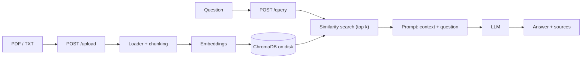

# RAG FastAPI Backend

Backend API to chat with your own documents (PDF and TXT) using Retrieval-Augmented Generation (RAG). Every answer comes with the sources it was based on.

**Status: working prototype.** It runs locally and in Docker; the limits and the roadmap are listed below.

## Features

- `POST /upload`: upload a PDF or TXT file. The text is split into chunks and stored in ChromaDB (saved on disk).
- `POST /query`: ask a question. The most similar chunks are retrieved and an LLM (OpenAI `gpt-4o-mini` by default) answers using only that context.
- Every answer includes its **sources** (file name, page, chunk id and the text used).
- `GET /health`: service status, number of indexed chunks, LLM and embedding provider.
- Settings loaded from a `.env` file, CORS configurable, Docker ready.

## Tech stack

Python, FastAPI, LangChain (LCEL), ChromaDB, OpenAI API, Pydantic, pytest, Docker

## How it works



1. **Ingestion:** the file is read (one document per PDF page), split with `RecursiveCharacterTextSplitter`, embedded and saved in ChromaDB.
2. **Query:** the question is embedded, the `k` most similar chunks are retrieved, numbered `[1]`, `[2]`, ... and passed to the LLM, which must cite them.
3. **Response:** the answer is returned together with the chunks used, so the user can check them.

## Design choices

- **Answers only from the documents:** the system prompt tells the model to reply with a fixed "not found" sentence when the context does not contain the answer.
- **Retrieved text is untrusted:** the prompt tells the model to ignore any instruction found inside the documents.
- **Sources in every answer:** file name, page (PDFs) and the text of each chunk used.
- **Idempotent ingestion:** chunk IDs come from the hash of the file content, so uploading the same file again updates the chunks instead of duplicating them.
- **Safe uploads:** file read in blocks with a size limit (`MAX_UPLOAD_MB`), allowed extensions only, temporary file always deleted.
- **Clear errors:** each failure maps to an HTTP status (see the table below).
- **Blocking work off the event loop:** embeddings, ChromaDB and PDF parsing run in threads; writes to the vector store are protected by a lock.
- **Centralized configuration and logging:** all settings come from `.env` through Pydantic Settings, and the log level is configurable (`LOG_LEVEL`).
- **Docker:** multi-stage build, non-root user, healthcheck on `/health`, volume for the vector database.

| Situation | HTTP status |
| --- | --- |
| Missing or invalid configuration (e.g. no API key) | 503 |
| No document indexed yet | 409 |
| Unsupported file format | 415 |
| File too large | 413 |
| Empty file | 400 |
| File without extractable text (e.g. scanned PDF) | 422 |
| OpenAI rate limit or quota | 429 |
| OpenAI rejects the key or returns an error | 502 |
| Cannot reach OpenAI | 503 |

## Project structure

```
app/
  main.py             # FastAPI app, routes, error handlers
  config.py           # settings from .env
  schemas.py          # request/response models
  document_loader.py  # file loading, chunking, ingestion
  rag_engine.py       # embeddings, vector store, RAG chain
tests/                # pytest suite (no network, no API key)
Dockerfile
requirements.txt
requirements-dev.txt
.env.example
```

## Run locally

Tested on Python 3.12 (the Dockerfile uses 3.11). On Windows, ChromaDB needs the Microsoft Visual C++ Redistributable: if you get `DLL load failed while importing chromadb_rust_bindings`, install it with `winget install -e --id Microsoft.VCRedist.2015+.x64` and reopen the terminal.

Windows (PowerShell):

```powershell
python -m venv .venv
.\.venv\Scripts\Activate.ps1
python -m pip install -r requirements.txt
Copy-Item .env.example .env   # then write your OPENAI_API_KEY in .env
python -m uvicorn app.main:app --reload
```

Linux / macOS:

```bash
python3 -m venv .venv
source .venv/bin/activate
python -m pip install -r requirements.txt
cp .env.example .env          # then write your OPENAI_API_KEY in .env
python -m uvicorn app.main:app --reload
```

Never commit `.env` (it is already in `.gitignore`). Interactive docs: http://127.0.0.1:8000/docs

## Example

```bash
curl -F "file=@document.pdf" http://localhost:8000/upload
curl -X POST http://localhost:8000/query -H "Content-Type: application/json" \
     -d '{"question": "What is this document about?"}'
```

Shape of the response of `/query` (the values below are only an illustration of the format, not a recorded run):

```json
{
  "question": "What is this document about?",
  "answer": "The document describes ... [1]",
  "sources": [
    {
      "source": "document.pdf",
      "page": 1,
      "chunk_id": "<file-hash>-0",
      "content": "text of the chunk used as context"
    }
  ]
}
```

## Tests

```bash
python -m pip install -r requirements-dev.txt
python -m pytest -q
```

The 38 tests use fake embeddings and a fake LLM, so they need no network and no API key. They cover configuration, request validation, document loading and chunking, idempotent ingestion, the query flow with sources and every API error status above.

## Known limits

- Retrieval is **semantic similarity search only**: there is no keyword (BM25) search, no hybrid search and no re-ranking.
- The quality of the answers is **not evaluated** yet: the tests check the plumbing, not the correctness of the LLM output.
- No authentication and no rate limiting: do not expose it publicly as it is.
- CORS is open (`*`) by default: set `CORS_ORIGINS` for anything beyond local use.
- All documents go into one shared collection, and there is no endpoint to delete a document.
- Scanned PDFs are not supported (they need OCR first).
- The LLM is OpenAI only; embeddings can be OpenAI or local Hugging Face models.

## Configuration (`.env`)

See `.env.example` for all the variables. The main ones:

| Variable | Meaning | Default |
| --- | --- | --- |
| `OPENAI_API_KEY` | OpenAI key (required for the LLM) | – |
| `LLM_MODEL` | Chat model | `gpt-4o-mini` |
| `EMBEDDING_PROVIDER` | `openai` or `huggingface` | `openai` |
| `COLLECTION_NAME` | ChromaDB collection (change it if you change embedding model) | `documents` |
| `CHUNK_SIZE` / `CHUNK_OVERLAP` | Chunking | `1000` / `200` |
| `RETRIEVER_K` | Chunks retrieved per question | `4` |
| `MAX_UPLOAD_MB` | Maximum upload size | `20` |
| `CORS_ORIGINS` | Allowed origins, comma-separated | `*` |

## Docker

```bash
docker build -t rag-backend .
docker run -p 8000:8000 --env-file .env -v rag_data:/app/chroma_db rag-backend
```

## Roadmap

- [ ] Hybrid retrieval (BM25 + vectors) and re-ranking
- [ ] Small evaluation set to measure answer quality
- [ ] Endpoint to list and delete documents
- [ ] API key authentication and rate limiting
- [ ] Streaming responses
- [ ] Use it as the knowledge-base tool of [ai-support-agent](https://github.com/moha10-hub/ai-support-agent)